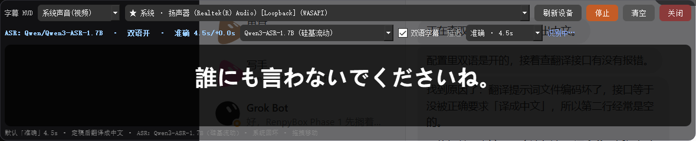
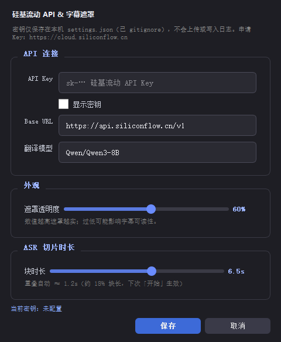
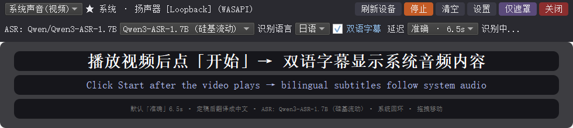

# 实时 ASR 字幕 Overlay

本地迷你应用：提供 **PyQt5 桌面置顶字幕 HUD**（推荐）和可选浏览器半透明页。默认捕获**系统播放声音**（视频/浏览器），PCM 在进程内打包为 16 kHz 单声道 WAV，调用**硅基流动（SiliconFlow）云端 ASR**，**不依赖 ffmpeg，不下载本地大模型**。

## Screenshots

| Overlay 工具栏 | 设置（Key 未配置 / 密码框） |
|---|---|
|  |  |

| 仅遮罩 | 双语字幕 |
|---|---|
|  |  |

## 支持的模型（仅硅基流动）

| UI / `ASR_PROVIDER` | 模型 ID | API |
|---|---|---|
| `qwen-sf`（默认） | `Qwen/Qwen3-ASR-1.7B` | `POST /v1/audio/transcriptions` |
| `sensevoice` | `FunAudioLLM/SenseVoiceSmall` | 同上 |

双语翻译与 ASR **共用同一 API Key / Base URL**（默认聊天模型 `Qwen/Qwen3-8B`，可在设置中改）。

## 快速开始（Windows）

```powershell
cd realtime-asr-subtitles
python -m venv .venv
.\.venv\Scripts\activate
pip install -r requirements.txt -i https://pypi.tuna.tsinghua.edu.cn/simple

# 方式 A：复制环境变量模板
copy .env.example .env
# 编辑 .env，填写 SILICONFLOW_API_KEY=

# 方式 B：先启动，再在窗口点「设置」填写 Key / Base URL（写入本机 settings.json）
python desktop_overlay.py
```

申请 API Key：[硅基流动控制台](https://cloud.siliconflow.cn)

### 桌面 Overlay 功能

- 无边框 + 置顶 + 半透明背景
- **设置**：API Key（密码框）、Base URL、翻译模型、**遮罩透明度**（即时预览，写入 `settings.json`）
- **延迟预设**：「实时」≈1.5s+0.5s；「准确」≈6.5s+1.2s（默认）；「更准」≈8.0s+1.5s
- **仅遮罩**：隐藏工具栏，只留字幕条（双击遮罩或 Esc 恢复）
- **音频源**：`系统声音(视频)`（默认） / `麦克风`；优先 WASAPI Loopback
- 识别语言锁定：日语 / 中文 / 英语；主字幕=原文，副字幕=简体中文
- 可拖拽移动

若提示没有回环设备：在「声音 → 录制」中启用「立体声混音」，或安装 [VB-Audio Cable](https://vb-audio.com/Cable/)。

## 可选：浏览器 + FastAPI

```powershell
uvicorn app.main:app --host 127.0.0.1 --port 8765
```

打开 http://127.0.0.1:8765 。前端用 `AudioContext` 采 PCM 打包 WAV，后端直传 SiliconFlow。

## 配置说明

| 位置 | 用途 |
|---|---|
| **设置对话框 → `settings.json`** | API Key、Base URL、翻译模型、遮罩透明度（推荐） |
| **`.env`** | 可选；延迟预设、默认语言等；也可放 Key |
| **`.env.example`** | 空占位模板（可提交） |

`settings.json` 与 `.env` 均已在 `.gitignore` 中，**请勿提交真实密钥**。

常用环境变量见 `.env.example`。

### 延迟预设

| 预设 | 切片 | 重叠 | 行为 |
|---|---|---|---|
| **实时** | 1.5s | 0.5s | 低延迟；短上下文 |
| **准确**（默认） | 6.5s | 1.2s | 更长上下文 + 边界重叠，更稳 |
| **更准** | 8.0s | 1.5s | 最长窗口，优先准确 |

## 数据流

1. WASAPI Loopback / 麦克风 采 float32 PCM  
2. 重采样 16 kHz mono → 进程内 WAV  
3. `httpx` POST 硅基流动 `/v1/audio/transcriptions`  
4. 定稿后可选双语翻译（同 Key 的 chat completions）

## 安全

- API Key 只放在本机 `settings.json` / `.env`，绝不写入前端或日志  
- 设置对话框用密码框；日志只记录「是否已配置」

## 目录

```
realtime-asr-subtitles/
  README.md
  LICENSE                 # MIT
  requirements.txt
  desktop_overlay.py      # 桌面置顶 HUD 入口
  .env.example
  .gitignore
  docs/screenshots/       # README 截图
  app/
    settings_store.py     # settings.json 读写
    settings_dialog.py    # 设置 GUI（Key / Base URL）
    asr_desktop.py        # 桌面 ASR 客户端
    asr_qwen.py / asr_sensevoice.py
    translate.py
    main.py               # 可选 FastAPI
  static/                 # 浏览器 UI
```

## License

[MIT](LICENSE) © Dclef
